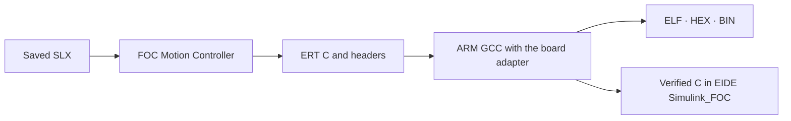

# ODrive 3.6 Simulink FOC

[](https://github.com/a233a2/odrive36-simulink-foc/actions/workflows/native-firmware.yml)


[](LICENSE)

**Run a three-loop Simulink FOC controller on ODrive 3.6 hardware.** The desktop tool generates C from the controller subsystem, builds STM32 firmware and installs the verified sources in EIDE.

[简体中文](README.zh-CN.md) · [Interface contract](docs/interfaces.md) · [Deployment guide](docs/deployment.md) · [Serial reference 中文](docs/serial_control.md) · [Releases](https://github.com/a233a2/odrive36-simulink-foc/releases)


## How it connects



The exported subsystem runs current FOC at **20 kHz** and updates its speed PI and position P loops at **1 kHz**. The STM32 firmware schedules ADC and PWM, reads the encoders, maintains per-axis state and handles faults. [Interface contract](docs/interfaces.md)

## Quick start

Use Windows x64, Python 3.12 with Tk, Arm GNU Toolchain and a licensed MATLAB R2024b installation with Simulink, MATLAB Coder, Simulink Coder and Embedded Coder.

```powershell
git clone https://github.com/a233a2/odrive36-simulink-foc.git
cd odrive36-simulink-foc
python tools/install_test_deps.py
python tools/deploy_gui.py
```

Open `simulink/odrive_foc.slx` and select **Run** to explore the PMSM and load-step demo. Set `demo_mode` to 1, 2 or 3 in the model workspace for torque, speed or position. Save controller edits, then choose **一键移植并构建** (Deploy and build) to install the verified C in `simulink/deployed/current/`. Open `CM_Odrive.code-workspace` and select **`Simulink_FOC`** to rebuild it in EIDE.

<details>
<summary>Command-line build and EIDE rebuild</summary>

```powershell
python tools/deploy_foc.py --install-project --verify-arm
python tools/build.py --simulink
```

Each deployment writes its firmware and manifest to `build/Simulink/<run>/`. The [deployment guide](docs/deployment.md) covers toolchain discovery, build outputs and Windows EXE packaging.

</details>

## USB serial control

Use **串口控制** (Serial Control) in the desktop tool or connect a serial terminal to the board's USB CDC port at 115200 8N1. Commands use ASCII lines. After preparing and calibrating an axis, send `torque 0 0.001` (N·m), `speed 0 1` (rad/s) or `position 0 0.1` (rad). Use `mode 0 position` and `set 0 0.1` to select the mode and set its target separately. The desktop UI sends a heartbeat after an acknowledged motion command, including calibration. The command reference covers setup, feedback, stopping and the **2 s** watchdog. [Serial reference 中文](docs/serial_control.md)

## Preview and validation

<table>
  <tr>
    <td width="50%"><a href="docs/media/deploy-tool.png"></a></td>
    <td width="50%"><a href="docs/media/serial-control.png"></a></td>
  </tr>
  <tr>
    <td>One-click offline deployment</td>
    <td>USB serial control</td>
  </tr>
</table>

All three modes passed the PMSM demo with a 1.4 mN·m load step. The generated controller passed **192 Simulink replay vectors** and **5,057 Cortex-M4 checks**. Both EIDE targets rebuilt successfully. Hardware timing and closed-loop commissioning are pending. [Simulation traces](docs/media/motion-modes.png)

The project is an independent development preview for ODrive 3.6–style hardware. The original model and source use the [MIT License](LICENSE). Third-party components keep their [upstream terms](THIRD_PARTY_NOTICES.md).
