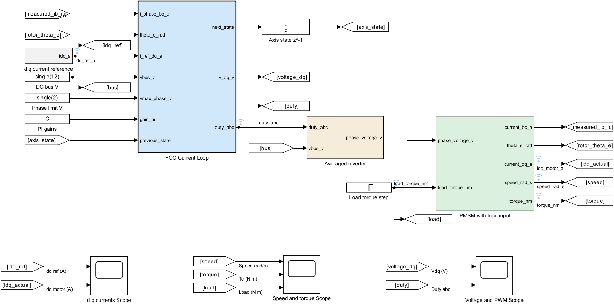
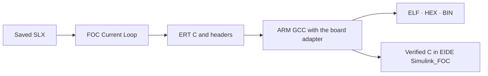
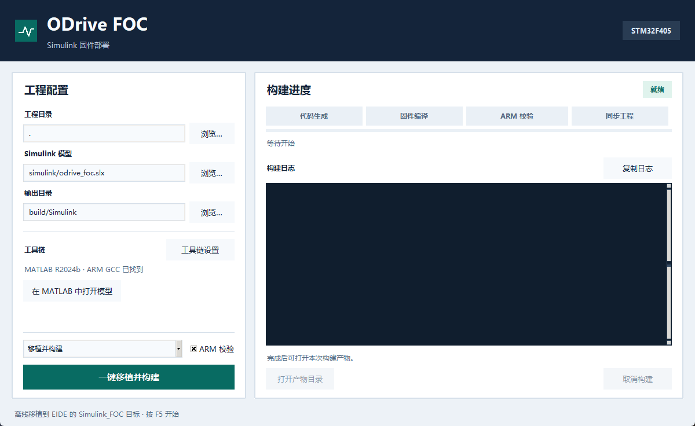
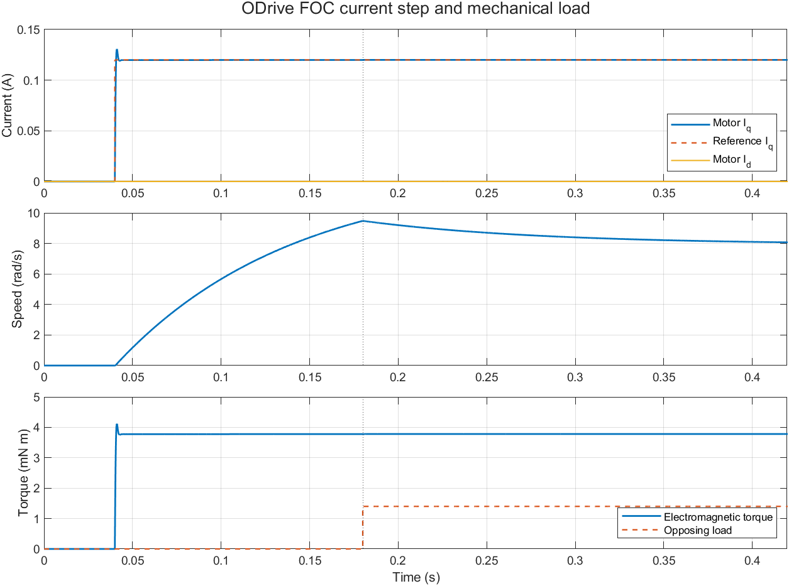

# ODrive 3.6 Simulink FOC

[](https://github.com/a233a2/odrive36-simulink-foc/actions/workflows/native-firmware.yml)


[](LICENSE)

**Take a Simulink FOC current loop from closed-loop simulation to STM32 firmware.** One action extracts the controller, generates ERT C, builds the firmware and publishes the verified sources to an EIDE target.

[简体中文](README.zh-CN.md) · [Interface contract](docs/interfaces.md) · [Deployment guide](docs/deployment.md) · [Releases](https://github.com/a233a2/odrive36-simulink-foc/releases)



## How it connects



The adapter maps phase currents, electrical angle and per-axis state into `odrive_foc_core_step()` at **20 kHz**. The firmware owns ADC/PWM scheduling, encoder feedback, outer loops and fault shutdown. Port order, units and state layout are documented in the [interface contract](docs/interfaces.md).

## Quick start

Use Windows x64, Python 3.12 with Tk, Arm GNU Toolchain and a licensed MATLAB R2024b installation with Simulink, MATLAB Coder, Simulink Coder and Embedded Coder.

```powershell
git clone https://github.com/a233a2/odrive36-simulink-foc.git
cd odrive36-simulink-foc
python tools/install_test_deps.py
python tools/deploy_gui.py
```

Open `simulink/odrive_foc.slx` in Simulink and select **Run** to explore the PMSM and load-step demo. Save your controller edits, then choose **一键移植并构建** (Deploy and build) in the desktop tool. The verified sources land in `simulink/deployed/current/`. Open `CM_Odrive.code-workspace` and select **`Simulink_FOC`** to rebuild them in EIDE.

<details>
<summary>Command-line build and EIDE rebuild</summary>

```powershell
python tools/deploy_foc.py --install-project --verify-arm
python tools/build.py --simulink
```

Each deployment writes its firmware and manifest to `build/Simulink/<run>/`. The [deployment guide](docs/deployment.md) covers toolchain discovery, build outputs and Windows EXE packaging.

</details>

## Preview and validation

<table>
  <tr>
    <td width="50%"><a href="docs/media/deploy-tool.png"></a></td>
    <td width="50%"><a href="docs/media/load-step.png"></a></td>
  </tr>
  <tr>
    <td>One-click offline deployment</td>
    <td>PMSM current step and load disturbance</td>
  </tr>
</table>

The preview passed **96 Simulink replay vectors**, **3,090 Cortex-M4 checks** and EIDE rebuilds of `Simulink_FOC` and `Debug`. The CI job covers the handwritten firmware and its ARM regression. Board timing and closed-loop hardware validation are in progress.

The project is an independent development preview for ODrive 3.6–style hardware. The original model and source use the [MIT License](LICENSE). Third-party components keep their [upstream terms](THIRD_PARTY_NOTICES.md).
