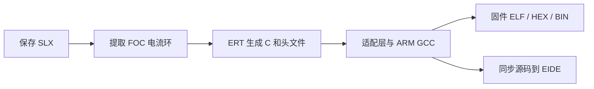
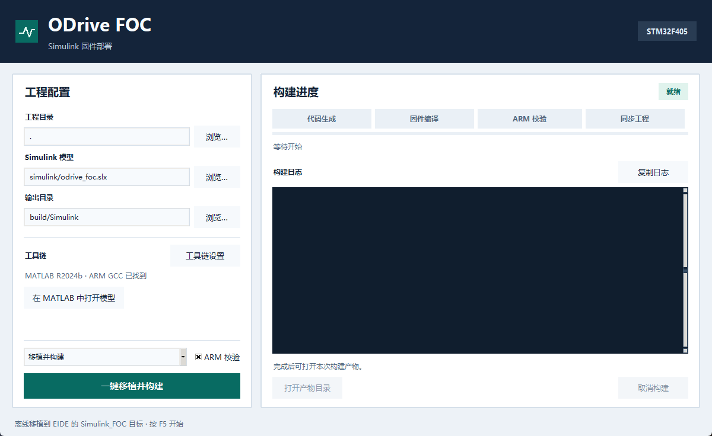
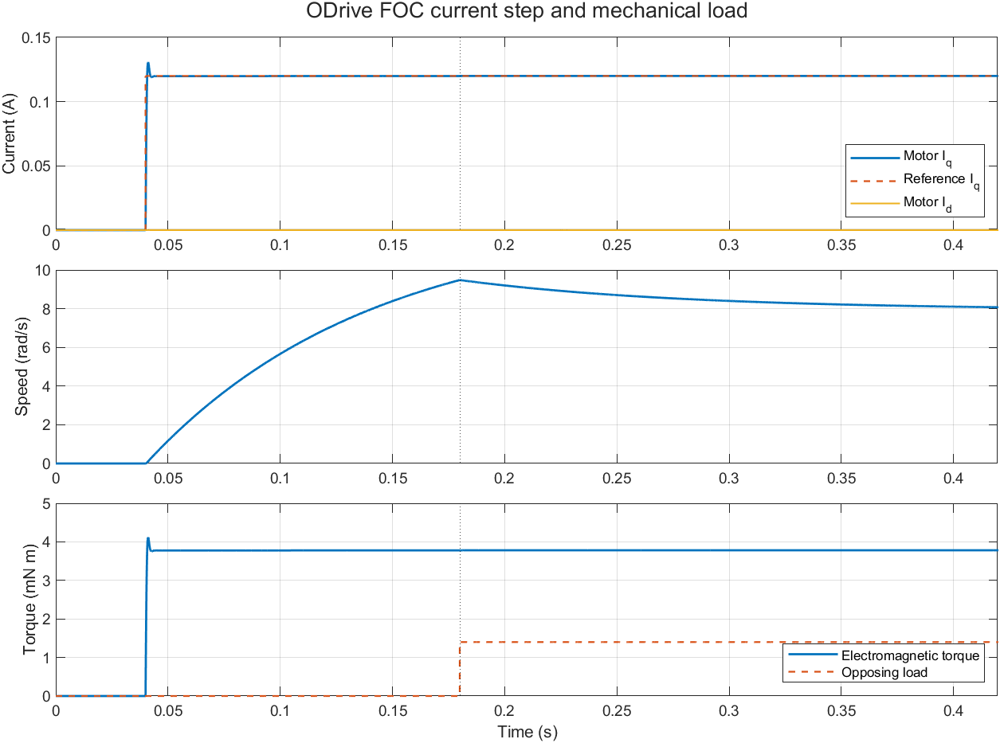

# ODrive 3.6 Simulink FOC

[](https://github.com/a233a2/odrive36-simulink-foc/actions/workflows/native-firmware.yml)


[](LICENSE)

**把 Simulink 电流环变成 ODrive 3.6 上可编译的 FOC 控制程序。** 上位机一键提取子系统、生成 C、编译 STM32 固件，并把通过验证的源码同步到 EIDE。

[English](README.md) · [接口契约](docs/interfaces.md) · [部署指南](docs/deployment.md) · [版本发布](https://github.com/a233a2/odrive36-simulink-foc/releases)


## 接口与部署



板级固件以 **20 kHz** 通过适配层传入相电流、电角度和各轴状态，调用 `odrive_foc_core_step()` 后检查占空比并更新 PWM。编码器、速度和位置外环、故障关断由板级固件执行。

## 快速开始

准备 Windows x64、带 Tk 的 Python 3.12、Arm GNU Toolchain，以及已授权的 MATLAB R2024b、Simulink、MATLAB Coder、Simulink Coder 和 Embedded Coder。

```powershell
git clone https://github.com/a233a2/odrive36-simulink-foc.git
cd odrive36-simulink-foc
python tools/install_test_deps.py
python tools/deploy_gui.py
```

打开 `simulink/odrive_foc.slx`，点 **Run** 查看电流阶跃和负载扰动。保存控制器改动后，在上位机点 **一键移植并构建**。生成源码同步到 `simulink/deployed/current/`。用 EIDE 打开 `CM_Odrive.code-workspace`，选择 `Simulink_FOC` 可以直接重编。

<details>
<summary>命令行操作</summary>

```powershell
python tools/deploy_foc.py --install-project --verify-arm
python tools/build.py --simulink
```

每次部署的固件、日志和清单位于 `build/Simulink/<run>/`。工具链设置和 Windows EXE 打包见[部署指南](docs/deployment.md)。

</details>

<table>
  <tr>
    <td width="50%"><a href="docs/media/deploy-tool.png"></a></td>
    <td width="50%"><a href="docs/media/load-step.png"></a></td>
  </tr>
  <tr><td>上位机部署界面</td><td>PMSM 电流跟踪与负载阶跃仿真</td></tr>
</table>

首发为开发预览。**96 组 Simulink 向量、3,090 项 ARM 检查**通过，EIDE 的 `Simulink_FOC` 和 `Debug` 均已重编通过。实机时序与闭环运行仍在验证。原创模型和源码采用 [MIT](LICENSE)，第三方组件沿用[原许可证](THIRD_PARTY_NOTICES.md)。
