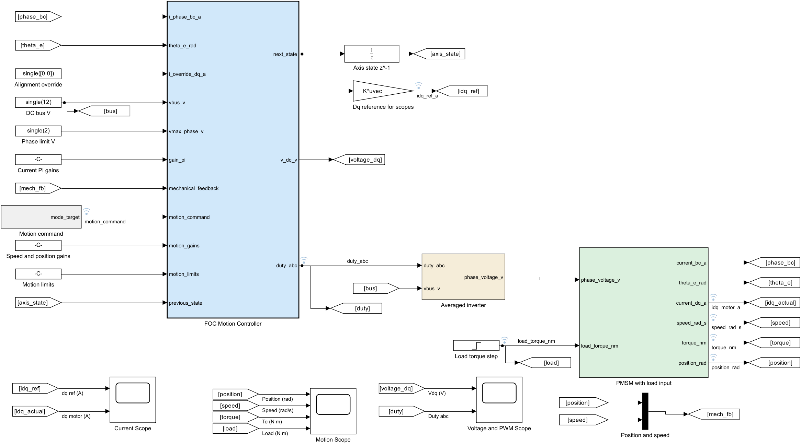
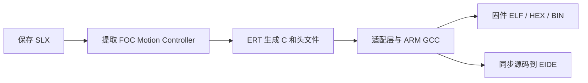
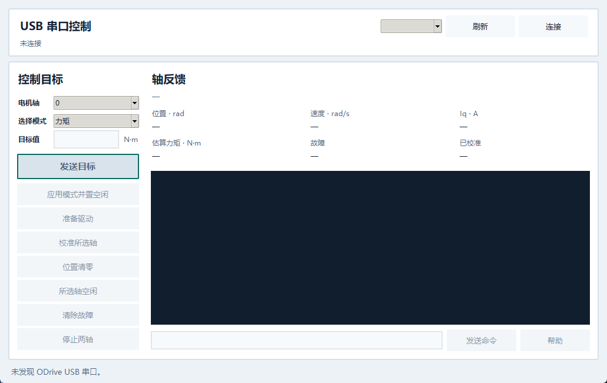

# ODrive 3.6 Simulink FOC

[](https://github.com/a233a2/odrive36-simulink-foc/actions/workflows/native-firmware.yml)


[](LICENSE)

**把 Simulink 电流、速度和位置三环部署到 ODrive 3.6。** 上位机一键提取控制子系统、生成 C、编译 STM32 固件，并把通过验证的源码同步到 EIDE。

[English](README.md) · [三环接口](docs/three_loop.md) · [部署指南](docs/deployment.md) · [串口命令](docs/serial_control.md) · [版本发布](https://github.com/a233a2/odrive36-simulink-foc/releases)



## 接口与部署



控制子系统含 **20 kHz** 电流环，以及 **1 kHz** 速度 PI 和位置 P。板级固件负责 ADC、编码器、校准、每轴状态、PWM 和故障关断。

## 快速开始

准备 Windows x64、带 Tk 的 Python 3.12、Arm GNU Toolchain，以及已授权的 MATLAB R2024b、Simulink、MATLAB Coder、Simulink Coder 和 Embedded Coder。

```powershell
git clone https://github.com/a233a2/odrive36-simulink-foc.git
cd odrive36-simulink-foc
python tools/install_test_deps.py
python tools/deploy_gui.py
```

打开 `simulink/odrive_foc.slx`，点 **Run** 查看 PMSM 和负载扰动。在模型工作区把 `demo_mode` 设为 1、2 或 3，分别运行力矩、速度或位置。保存改动后，在上位机点 **一键移植并构建**，生成源码同步到 `simulink/deployed/current/`。用 EIDE 打开 `CM_Odrive.code-workspace`，选择 `Simulink_FOC` 重编。

<details>
<summary>命令行操作</summary>

```powershell
python tools/deploy_foc.py --install-project --verify-arm
python tools/build.py --simulink
```

每次部署的固件、日志和清单位于 `build/Simulink/<run>/`。工具链设置和 Windows EXE 打包见[部署指南](docs/deployment.md)。

</details>

## USB 串口控制

在上位机打开 **串口控制**，或用通用串口终端连接板载 USB 虚拟 COM 口，设为 115200 8N1。准备和校准后，可发送 `torque 0 0.001`（N·m）、`speed 0 1`（rad/s）或 `position 0 0.1`（rad）。也可用 `mode` 选模式，再用 `set` 更新目标。命令表包含校准、反馈、停机、心跳和 Kt 设置。[串口命令](docs/serial_control.md)

<table>
  <tr>
    <td width="50%"><a href="docs/media/deploy-tool.png"></a></td>
    <td width="50%"><a href="docs/media/serial-control.png"></a></td>
  </tr>
  <tr><td>上位机部署界面</td><td>USB 串口控制</td></tr>
</table>

三种模式均通过 1.4 mN·m 负载阶跃仿真。生成版通过 **192 组 Simulink 向量、5,057 项 ARM 检查**，EIDE 的 `Simulink_FOC` 和 `Debug` 均已重编。实机时序和闭环运行待验证。[仿真曲线](docs/media/motion-modes.png)

原创模型和源码采用 MIT，第三方组件沿用各自许可。[MIT](LICENSE) · [第三方许可](THIRD_PARTY_NOTICES.md)
