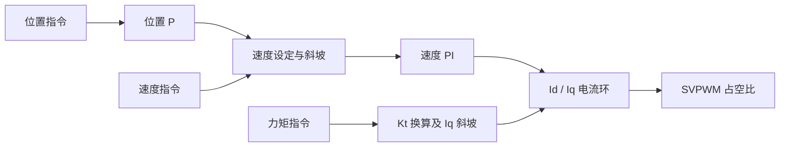
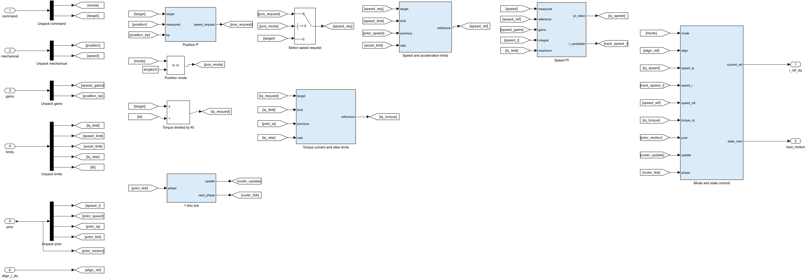

# 三环 Simulink 控制与固件接口

外层模型 `odrive_foc.slx` 包含平均逆变器、PMSM、可调负载和示波器。部署仅导出 **`FOC Motion Controller`**。其中电流子系统运行于 20 kHz，位置 P 和速度 PI 的状态及参考值按每 20 次内环调用更新一次。

## ABI v2

模型按以下顺序使用 `single` 根端口。`motion_command` 的模式号 `1`、`2`、`3` 分别对应力矩、速度、位置。模式号 `0` 用于电角度校准，接收直接的 dq 参考。

| 输入 | 宽度 | 内容 |
| --- | ---: | --- |
| `i_phase_bc_a`、`theta_e_rad` | 2、1 | Ib、Ic（A），电角度（rad） |
| `i_override_dq_a` | 2 | 校准时的 Id/Iq（A） |
| `vbus_v`、`vmax_phase_v` | 1、1 | 母线与相电压上限（V） |
| `gain_pi` | 4 | 电流环 Kp_d、Ki_d、Kp_q、Ki_q |
| `mechanical_feedback` | 2 | 机械位置（rad）、机械速度（rad/s） |
| `motion_command` | 2 | 模式号、目标（N·m / rad/s / rad） |
| `motion_gains` | 3 | 速度 Kp、速度 Ki、位置 Kp |
| `motion_limits` | 5 | 电流上限、速度上限、加速度上限、Iq 斜率、Kt |
| `previous_state` | 8 | 滤波后 Id/Iq、d/q 积分、速度积分、速度参考、Iq 参考、分频相位 |

输出为 `next_state[8]`、`v_dq_v[2]`、`duty_abc[3]`。ADC 中断将同一轴的输入和状态送入 `foc_motion_step()`。适配层调用生成的 `odrive_foc_core_step()`，校验状态、电压和占空比后交给板级固件。每轴独立保留状态，模式变更时重置。板级负责采样、编码器、校准、PWM 调度和保护。

## 生成和验证

打开 SLX，修改模型工作区的 `demo_mode`、`demo_target` 和 `demo_load_nm` 可以改变场景。运行 `verify_odrive_motor_demo` 会依次检查三种模式的负载阶跃。仿真增益和机械参数用于观察控制响应。实机使用 `include/config.h` 的板级配置和每轴配置的 Kt。

在部署工具点击「一键移植并构建」会对 ABI 和产物做校验，同步到工程。命令行同等入口为 `python tools/deploy_foc.py --install-project --verify-arm`。EIDE 的 `Simulink_FOC` 和 `Debug` 分别构建生成 C 版和手写 C 版。

[三种模式的负载阶跃曲线](media/motion-modes.png)

[模型契约](../simulink/odrive_foc_contract.m) · [生成版适配层](../simulink/firmware/foc_simulink.c) · [串口指令](serial_control.md)
